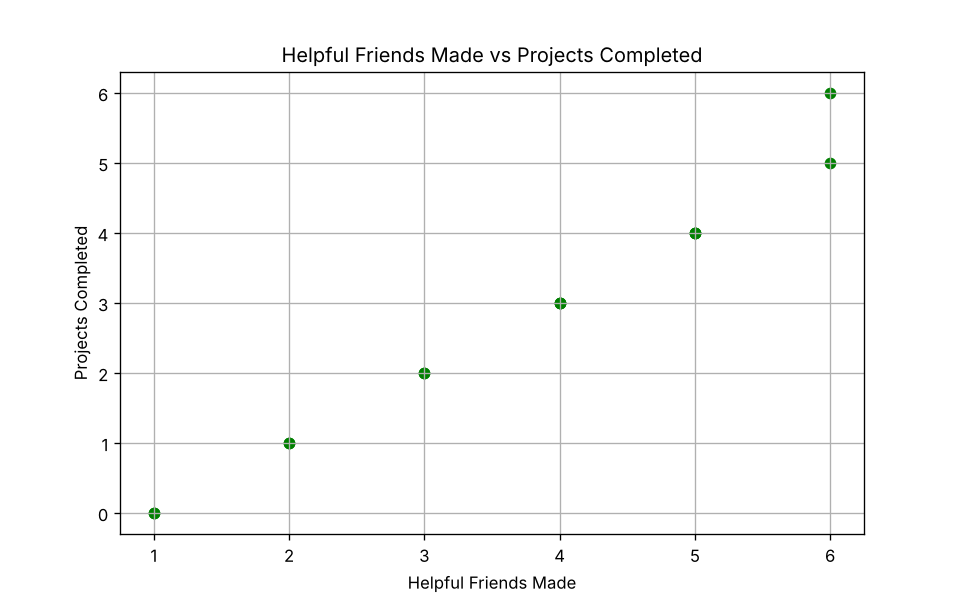

# 🤝 Friends, Foes & Office Productivity


This project humorously analyzes how **making the right friends** and **avoiding the wrong people** at work affects your ability to get projects done.

## 📊 Features
- Tracks **Helpful Friends Made**, **People to Avoid**, **Projects Completed**, **Coffee Breaks Together**, **Lunch Gossip Sessions**, and **Emails Ignored**
- Generates **two key insights**:
  - How friends boost productivity
  - How avoiding the wrong people prevents chaos
- Produces fun scatter plots to prove (or disprove) your office theories

## 🚀 How to Run
1. Install Python 3 & dependencies:
   ```bash
   pip install -r requirements.txt
   ```
2. Run the analysis:
   ```bash
   python analyze_work_friends.py
   ```
3. Run the tests:
   ```bash
   pytest
   ```

## 📈 Example Output



## 📈 Example Insights
- More friends = more projects (unless your friends are *too* fun)
- Avoiding a select few might be the secret to hitting deadlines
- Lunch gossip sessions remain an under-researched area of productivity science

## 🎯 Goal
To scientifically (but not really) prove that workplace success is 50% knowing the right people and 50% knowing who to dodge in the hallway.

---
Made with ☕, 🥪, and the occasional "Let’s circle back next week."
